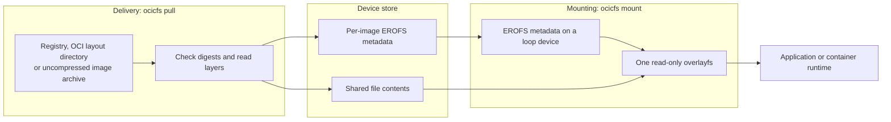

# ocicfs

ocicfs pulls OCI container images and mounts them as read-only filesystems
on Linux. It is built for edge and embedded devices with slow links and
small flash storage. Each distinct file is stored once and shared by every
image that contains it.

ocicfs is a CLI and a [Go library](pkg/ocicfs/engine.go) for update agents
and container runtimes. Images remain standard OCI images.

## Why ocicfs?

A conventional container pull downloads each changed layer whole,
decompresses it and unpacks it into its own directory. On a device with a
slow link and small flash this costs:

- **Bandwidth.** Rebuilding a layer changes its digest, so an update
  downloads the whole layer even when only a few files in it changed.
- **Storage.** Shared layers are stored once, but a file present in two
  different layers is stored once per layer.
- **Time.** Every layer is decompressed and unpacked before use.

ocicfs shares files across layers, images and releases. A layer read by an
earlier pull is normally not read again. Optional delta pulls can download
only missing files. Mounting uses prepared metadata and the shared file
store, so it needs no layer unpacking.

## How it works

ocicfs separates file contents from their names, ownership and permissions.
It uses [composefs](https://github.com/composefs/composefs) to join them at
mount time.



**Pull.** ocicfs checks the manifest, config and layers against their
digests. Plain pulls read whole layers in gzip, zstd or uncompressed form.
They need no special layer format.

With `--delta`, ocicfs fetches only missing files, using byte ranges into
`zstd:chunked` layers (standard zstd layers that carry a per-file table of
contents). It reads a layer whole if the layer has no table of contents or
ranges would not save enough data.

File contents are keyed by their SHA-256 digest. Names, ownership,
permissions and file digests go into a per-image filesystem image in EROFS
format. Files of 64 bytes or fewer are inlined there. Compressed layers are
not kept in the store. A delta pull may keep a whole layer in a temporary
file until the pull ends.

**Mount.** ocicfs attaches the EROFS metadata to a loop device. It creates
one read-only overlayfs with the shared store as a data-only lower layer.
File data is read on demand. There is no daemon.

**Integrity and trust.** Stored files and EROFS images are protected by
[fs-verity](https://docs.kernel.org/filesystems/fsverity.html). This kernel
feature checks content against a recorded digest as it is read from disk.
The overlay is mounted with `verity=require`, so the kernel refuses to
serve a file whose content does not match the digest in the metadata.
These checks detect corruption and tampering. They do not establish who
published an image.

Publisher trust starts with a digest-pinned reference supplied by the
caller. A publisher can also run `ocicfs seal` to push a manifest annotated
with the expected EROFS digest. Pull and mount reject a mismatch. For an
unsealed image, mount checks the EROFS digest recorded locally at pull.
See [mount notes](docs/mount.md#notes).

## Capabilities

| Capability | Commands |
|---|---|
| Pull from an OCI registry by digest or tag | `pull` |
| Import an OCI layout directory | `pull --from-dir` |
| Import an uncompressed archive (compressed archives are refused) from `docker save`, skopeo or `ocicfs copy` | `pull --from-tar` |
| Save registry images to an archive for offline delivery | `copy` |
| Use file-level delta downloads | `pull --delta` |
| Mount read-only or expose metadata for your own overlay | `mount`, `mount --metadata-only`, `unmount` |
| Record the expected EROFS digest in a published manifest | `seal` |
| List, inspect and remove stored images | `ls`, `inspect`, `remove` |
| Pin an image against `remove` and `gc`, or release the pin | `hold`, `release` |
| Reclaim content no image wants and no mount uses | `gc` |

Not available today:

- **Writable mounts.** `mount --rw` is rejected. Use
  `mount --metadata-only` and add your own writable overlay.
- **`publish`.** The command is registered but returns "not implemented".
- **Standalone verification.** There is no `verify` command. Verification
  runs inside `pull` and `mount`.

## Quick start

You need Linux 6.6 or newer, root, and a store on a filesystem with
fs-verity enabled. You also need `mkcomposefs` from the composefs tools;
it is needed by `pull` and `seal` only.

See [runtime requirements](INSTALL.md#runtime-requirements) and the
[loopback ext4 setup](docs/mount.md#no-fs-verity-filesystem-create-one-on-a-loop-device)
if your filesystem lacks fs-verity.

```sh
image=docker.io/library/busybox:latest
sudo ocicfs pull "$image"
sudo ocicfs inspect "$image"
sudo mkdir -p /mnt/busybox
sudo ocicfs mount "$image" /mnt/busybox
ls /mnt/busybox
sudo ocicfs unmount /mnt/busybox
```

The store defaults to `/var/lib/ocicfs`. Use `--root` to select another
location. `inspect` and `mount` resolve tags from the local pull record,
never over the network.

Tags are fine for trying ocicfs. In production, pull digest-pinned
references (`name@sha256:<digest>`). The digest is the trust anchor.

## Scope and status

ocicfs provides primitives, not lifecycle policy. It does not run
containers or decide which version is active, when to update or when to
roll back. Those decisions belong to the update agent or container runtime.

[cfs-snapshotter](https://github.com/foundriesio/cfs-snapshotter) integrates
ocicfs with containerd and Docker. It uses metadata-only mounts and adds
the writable overlay containers need.

**Status: early development.** The commands in the
[capabilities table](#capabilities) are implemented end to end and covered
by the repository's tests.

## Documentation

- **Use:** [installing](INSTALL.md), [pulling and offline import](docs/pull.md),
  [mounting](docs/mount.md), [sealing](docs/seal.md).
- **Manage the store:** [inspect](docs/inspect.md),
  [list and remove](docs/ls-remove.md), [holds and gc](docs/gc.md).
- **Understand the design:** [why ocicfs exists](docs/why.md),
  [ADR 0001: architecture](docs/adr/0001-high-level-architecture.md),
  [ADR 0002: image identity](docs/adr/0002-image-identity.md),
  [on-disk store layout](docs/on-disk-layout.md),
  [hands-on storage walkthrough](docs/storage-walkthrough.md).

## Development

Development runs in a pinned dev container (`.devcontainer/`, built from the
`Containerfile`) so the Go toolchain and linters match CI. It needs Docker and
the [`devcontainer` CLI](https://github.com/devcontainers/cli):

```sh
./devshell.sh        # build/start the container and open a shell (removed on exit)
./devshell.sh exec   # open another shell in the running container (left running)
```

Inside the shell, the make targets behave exactly as they do in CI:

```sh
make            # stripped binary into bin/ (the default)
make check      # lint, vet, unit tests
make test       # unit tests
make lint       # gofumpt + golangci-lint
make test-e2e   # end to end: every verb, every pull source, seal, gc, delta
```

Where each target runs:

| Target | Dev host | Dev container |
|---|---|---|
| `make`, `build`, `size`, `clean` | yes | yes |
| `install` | yes, as root or with a writable `PREFIX` or `DESTDIR` | yes |
| `check`, `test`, `vet`, `lint`, `fmt` | yes, with Go and golangci-lint installed; tests that need root, fs-verity or mkcomposefs skip themselves | yes, full coverage as in CI |
| `test-e2e` | no: needs a privileged environment with fs-verity and mkcomposefs | yes |
| `deb`, `deb-lint`, `deb-test` | yes, with Docker: they build in their own container | not needed |

## Contributing

Contributions are welcome. ocicfs is developed in the open and follows the
conventions of the composefs and containerd communities. Please read
[CONTRIBUTING.md](CONTRIBUTING.md) and the [Code of Conduct](CODE-OF-CONDUCT.md)
first. All commits must be signed
off under the [Developer Certificate of Origin](https://developercertificate.org/)
(`git commit -s`), and pull requests must be opened and reviewed by a human.
Automated coding agents must additionally follow [AGENTS.md](AGENTS.md).

## License

ocicfs is licensed under the [Apache License 2.0](LICENSE).

Copyright (c) Qualcomm Technologies, Inc. and/or its subsidiaries.
